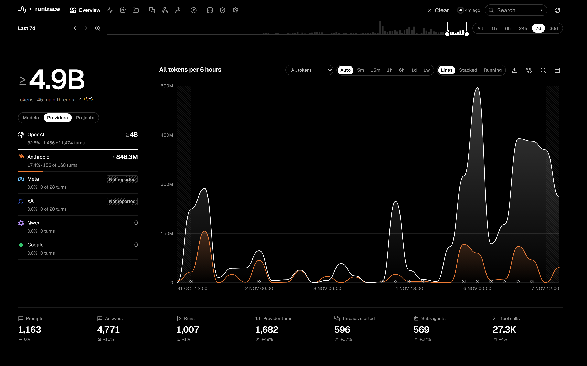

# Runtrace

See where your coding agents' work goes. Runtrace reads your [T3 Code](https://github.com/pingdotgg/t3code) history on your own computer and shows tokens over time by model, provider and project, provider turns, tool calls, sub-agent trees, quota and what each number can and cannot support. Nothing leaves your computer.



## Install

You need T3 Code installed and used on the same computer. Runtrace finds its history by itself.

**Windows** (PowerShell):

```powershell
irm https://github.com/Dytschgo/runtrace/releases/latest/download/install.ps1 | iex
```

**macOS and Linux**:

```sh
curl -fsSL https://github.com/Dytschgo/runtrace/releases/latest/download/install.sh | sh
```

The installer downloads the program for your system, checks it against the release's published checksums, starts Runtrace and opens the dashboard at **http://127.0.0.1:4310**. The first start reads your whole T3 history, which can take a few minutes; the dashboard fills in as it goes.

Prefer to do it by hand? Download the file for your system from the [latest release](https://github.com/Dytschgo/runtrace/releases/latest), check it against `SHA256SUMS`, and run `runtrace start --open`.

| System | File |
|---|---|
| Windows (x64) | `runtrace-x86_64-pc-windows-msvc.exe` |
| macOS (Apple silicon) | `runtrace-aarch64-apple-darwin` |
| macOS (Intel) | `runtrace-x86_64-apple-darwin` |
| Linux (x64, glibc 2.35+) | `runtrace-x86_64-unknown-linux-gnu` |

## Use

```sh
runtrace start           # start in the background; add --open to open the dashboard
runtrace open            # open the dashboard (starting it if needed)
runtrace status          # running or not, version, and where settings, data and logs are
runtrace stop
runtrace autostart on    # start when you log in (off to undo)
```

## Updates

Runtrace looks for a new release about once a day. When one exists, an **Update** button appears in the dashboard's top bar. One click backs up your database, installs the new version and restarts; the page reloads by itself. Nothing installs without you asking.

From a terminal: `runtrace update --check` reports, `runtrace update` installs. To turn the daily check off, set `check = false` under `[update]` in the settings file.

## Where things live

| | Windows | macOS | Linux |
|---|---|---|---|
| Settings, data, logs | `%LOCALAPPDATA%\Runtrace` | `~/Library/Application Support/Runtrace` | `~/.local/share/runtrace` |
| Program | `%LOCALAPPDATA%\Runtrace\bin` | `~/.local/bin` | `~/.local/bin` |

`runtrace status` prints the exact paths. Settings are in `config.toml` there, with comments; restart after a change.

## Privacy

- Runtrace opens T3's database read-only and never changes it. It never reads T3 credentials.
- The dashboard listens on 127.0.0.1 only, so other computers cannot reach it.
- Conversation text is stored with secrets removed (`redacted_only`). Set `default_policy = "metadata_only"` to keep no text at all, or `full_encrypted` to keep it encrypted with a key in your system's keychain.
- The only network request Runtrace makes is the daily release check to GitHub, which sends nothing about you or your data. Turn it off as above.
- Pause capture at any time with `runtrace capture pause`; purge a thread or project with `runtrace purge thread <id>` / `runtrace purge project <id>`.

Details: [security](docs/security.md), [threat model](docs/threat-model.md).

## Uninstall

Run `runtrace autostart off` and `runtrace stop`, then delete the program and the folder `runtrace status` names. Your T3 history is not affected.

## Ask your agents about it (MCP)

Runtrace includes a read-only MCP server with twenty tools and eight analysis prompts, for clients that support stdio MCP:

```json
{ "mcpServers": { "runtrace": { "command": "runtrace", "args": ["mcp", "serve"] } } }
```

Full conversation content is never available through MCP. See [MCP details](docs/mcp.md).

## Build from source

You need Rust (stable) and Node.js 24.

```sh
cd dashboard && npm ci && npm run build && cd ..   # the program embeds the built dashboard
cargo build --release                              # target/release/runtrace
```

Tests: `cargo test --workspace`, and in `dashboard/`: `npm test` (unit) and `npx playwright test` (browser, against a synthetic database with a pinned clock). See [development](docs/development.md).

### Publishing a release

Bump `version` in `Cargo.toml`, commit, then tag and push: `git tag v0.3.0 && git push origin v0.3.0`. The release workflow builds every platform, runs each build once, writes `SHA256SUMS`, and publishes the release that installers and `runtrace update` read.

## What the numbers mean

Runtrace never shows a guess as a fact. Unknown values are hatched, not zero; sums that are missing some turns are marked as lower bounds (≥); token usage from agents' session logs counts toward tokens but never as turns. See [metrics](docs/metrics.md), [data model](docs/data-model.md) and [known limitations](docs/known-limitations.md).

## License

MIT
